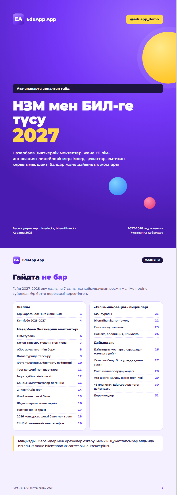

# NIS & BIL Admission Guide 2027 — print-ready HTML booklet

A 31-page A4 parents' guide to admission into Nazarbayev Intellectual Schools (НЗМ / NIS) and Bilim-Innovation Lyceums (БИЛ / BIL) for 2027, built entirely in HTML + CSS for print. Open it in a browser and "Print → Save as PDF" to get a ready booklet.



## Features

- **Print-first layout** — `@page { size: A4; margin: 0 }`, every `<section class="page">` is exactly one A4 sheet, millimetre-based spacing, running headers and page numbers.
- **Design system in CSS variables** — brand gradient, ink/paper colours, accent chips per track (NIS / BIL / prep), reusable components: cover, table of contents, timeline, dense tables, bar charts, notes, checklists, "planet" decorations.
- **Inline SVG sprite** for the logo (placeholder "EA" mark) — no image requests.
- **Self-hosted variable font** — Montserrat (SIL OFL 1.1, see `fonts/OFL.txt`) with `unicode-range` subsets for Cyrillic / Kazakh / Latin, so the booklet renders identically offline.
- Content in Kazakh: timeline 2026–2027, document submission via eGov, photo requirements, exam format and scoring, thresholds and grants, school addresses, BIL registration and exam structure, a month-by-month prep plan, time-per-question tips. Each page cites its official source (nis.edu.kz, bilemtihan.kz).

## Tech stack

HTML5 · CSS3 (paged media, grid, flexbox, custom properties) · inline SVG · WOFF2 web fonts.

## Project structure

```
guide.html            the whole booklet (31 A4 pages, inline CSS + SVG)
fonts/montserrat.css  @font-face rules with unicode-range subsets
fonts/*.woff2         Montserrat subsets (OFL)
fonts/OFL.txt         font license
docs/screenshot.png
```

## How to run (demo mode)

Nothing to install — open `guide.html` in Chrome/Edge. To export a PDF: Print → "Save as PDF", paper A4, margins "None", enable "Background graphics". Or headless:

```bash
chrome --headless --print-to-pdf=guide.pdf --no-pdf-header-footer guide.html
```

> All data in this repository is randomly generated; brand names are anonymized. "EduApp", its logo, handles and contact numbers are fictional. Admission rules, dates and school addresses are taken from public official sources (nis.edu.kz, bilemtihan.kz) and may change — always verify there.

## Қысқаша (KZ)

НЗМ мен БИЛ-ге 2027 жылы түсу бойынша ата-аналарға арналған 31 беттік A4 гайд, толығымен HTML + CSS-пен жасалған.
Браузерде ашып, «Басып шығару → PDF ретінде сақтау» арқылы дайын буклет аласыз.
Мерзімдер, құжаттар, емтихан құрылымы, шекті балдар және дайындық жоспары ресми дереккөздерге сүйенеді.
Қаріп — Montserrat (SIL OFL 1.1). Бренд атаулары мен байланыс деректері ойдан шығарылған.
